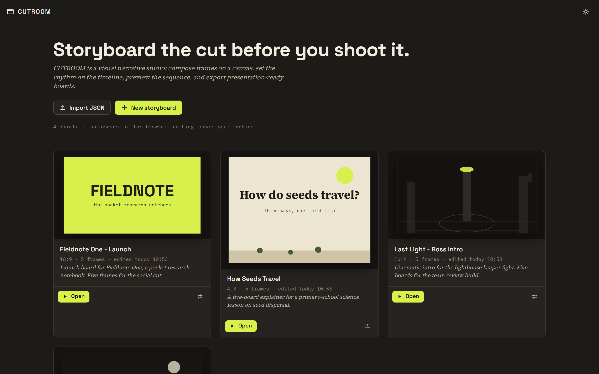
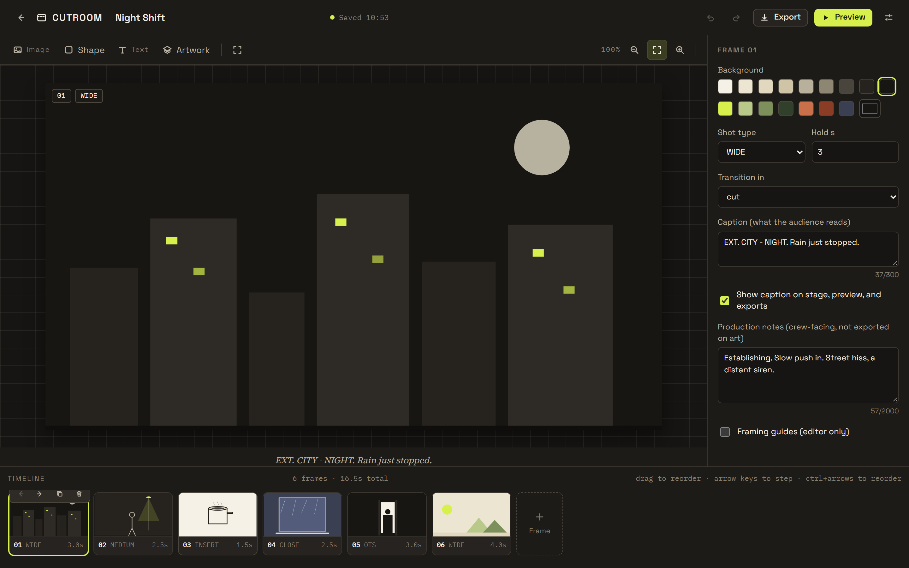
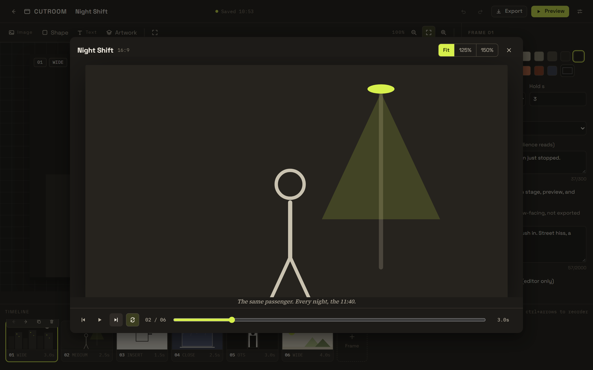
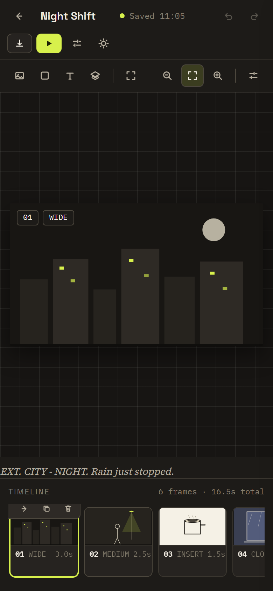

# CUTROOM

Storyboard the cut before you shoot it. CUTROOM is a cinematic storyboard and visual narrative studio that runs entirely in the browser.

[](https://cutroom-green.vercel.app)
[](https://github.com/devtechedge/cutroom/actions/workflows/ci.yml)
[](https://vite.dev)
[](https://react.dev)
[](https://www.typescriptlang.org/)
[](LICENSE)

## Live Demo

**[cutroom-green.vercel.app](https://cutroom-green.vercel.app)**

> **Status:** CUTROOM is client-only. Boards and uploaded images stay in your browser's IndexedDB, on your device. There is no account, no server and no telemetry, and the app makes no external requests after it loads. Clearing site data removes the boards.

## Screenshots

| Gallery | Editor |
| --- | --- |
|  |  |
| **Preview** | **Phone editor** |
|  |  |

## Features

- **Four starter boards** to open, edit or clear: a short film, a product launch, a science lesson and a game cinematic.
- **Frame composition** with image, shape, text and vector artwork objects, plus drag, resize, keyboard nudging, guides and zoom.
- **Group editing** with shift-click and marquee multi-select, group drag and nudge, copy/paste, duplicate, and batch delete.
- **Board URLs** at `#/board/<id>` with reload restore, browser Back and per-board titles.
- **Shot rhythm** through per-frame hold, shot type and transition, with drag or keyboard reordering on the timeline.
- **Preview playback** with cut, dissolve and slide transitions, a reduced-motion fallback, looping and frame stepping.
- **Exports** as a multi-page contact sheet in PNG or SVG (one ZIP for multiple pages), a print-ready sheet for PDF, a single frame in PNG, or the whole project as JSON with its images included.
- SVG sheets use the same font stacks with system fallbacks, so they stay readable on machines without the bundled families.
- **Validated imports** that rebuild a board field by field through a whitelist sanitizer and report every issue instead of failing silently.
- **Local-first persistence** with debounced autosave, an honest in-memory fallback when storage is blocked, and orphaned asset cleanup.
- **Backup and recovery** with a whole-library backup file, validated restore, a 30-day Recently deleted bin with restore and permanent delete, and a backup reminder.
- **Recovery and tab safety** with a boot error screen, an error boundary, an unsaved-change warning and a two-tab notice.
- **Light and dark themes** with keyboard paths for frames, objects, reordering and preview.
- **Public pages** at `#/welcome`, `#/privacy`, `#/terms` and `#/contact`, with product positioning, audience, how it works, FAQ and feedback routes.
- **Strict production policy**: no accounts, no runtime network calls, a Content-Security-Policy and security headers.

## Tech Stack

| Layer | Choice |
| --- | --- |
| App | Vite 7, React 19, strict TypeScript |
| Rendering | One primitive source shared by the live stage, PNG canvas and SVG export |
| State | Immutable storyboard model with labelled undo and redo |
| Storage | IndexedDB with an in-memory fallback |
| Type | Space Grotesk, Source Serif 4 and IBM Plex Mono, self-hosted |
| Tests | Vitest unit suite and Playwright end-to-end suite |

## Quick Start

Requires Node 22 or newer.

```bash
npm ci
npm run dev      # http://localhost:5210
```

```bash
npm run typecheck
npm run lint
npm run test:coverage
npm run e2e      # builds the app, then runs the browser suite
npm run build && npm run check:csp
```

## Product and roadmap

- [Product notes](docs/PRODUCT.md): position, audience, success signals, pricing hypothesis and design partners.
- [Roadmap](docs/ROADMAP.md): sharing, version history, sync and collaboration, ordered by risk.
- [Architecture](docs/ARCHITECTURE.md): rendering, state, storage, routing and exports.
- [Custom domain plan](docs/DOMAIN.md): why IndexedDB does not follow a redirect and how to migrate users safely.

Public pages are part of the app: `#/welcome`, `#/privacy`, `#/terms` and `#/contact`.

## License

MIT. Font licenses and asset provenance are listed in [LICENSES.md](LICENSES.md).

Security reports: see [SECURITY.md](SECURITY.md).
